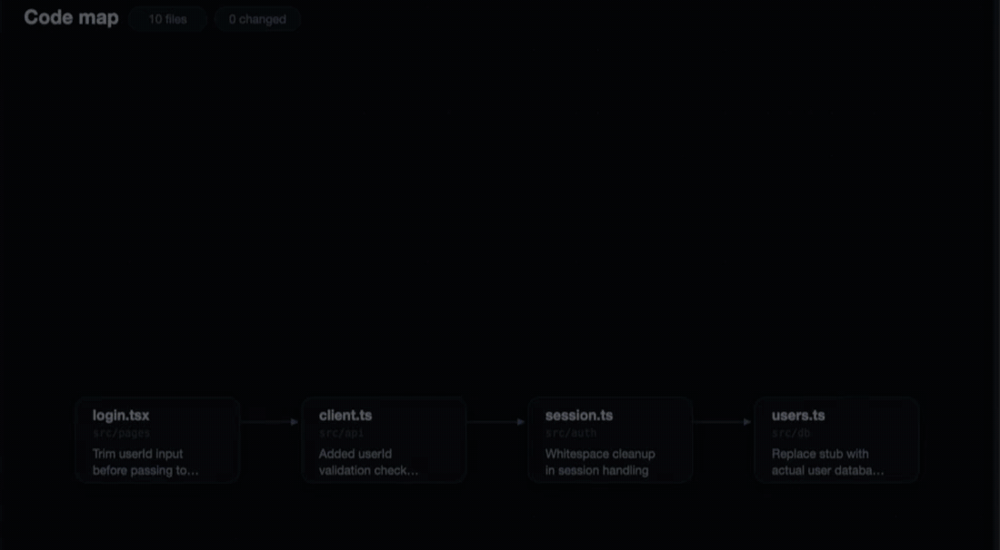
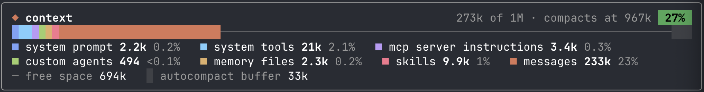
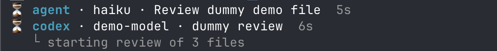
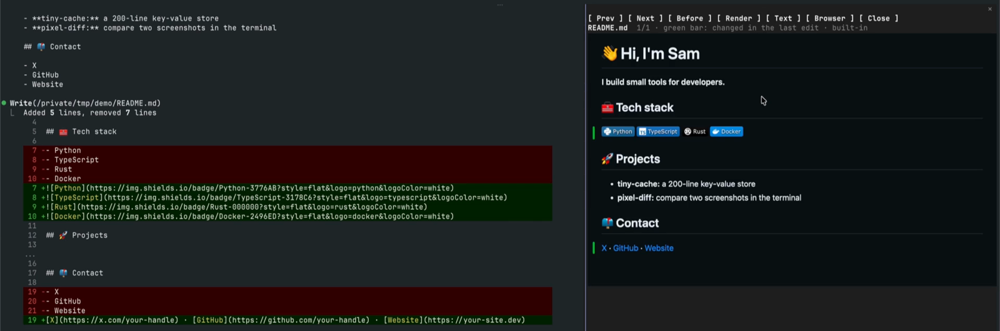
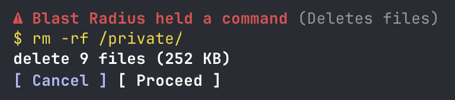
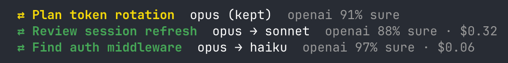
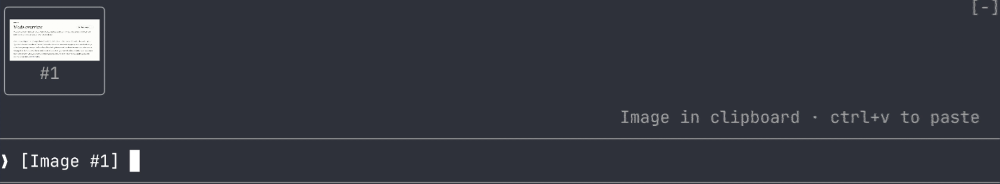

<p align="center"></p>

<h1 align="center">Claude Code mods</h1>

<p align="center"><b>Make Claude Code show what it's doing.</b><br>Plugins for Claude Code, built on function hooks: live lines above the prompt, guards, panes and games. Install only the ones you want.</p>

<p align="center">
  <a href="https://www.npmjs.com/package/claude-code-mods"></a>
  <a href="LICENSE"></a>
  <a href="https://github.com/hamzafer/claude-code-mods/actions/workflows/ci.yml"></a>
</p>

<a id="mission-control"></a>



<p align="center"><sub><b>mission-control</b>: every subagent, tool call and file they touch, live. Shown at 4x. <a href="docs/mods.md#%EF%B8%8F-mission-control">Details</a></sub></p>

<a id="-install"></a>

## Install

```sh
npx claude-code-mods@latest
```

Tick the mods you want, press Enter, restart Claude Code. Needs Claude Code 2.1.287+. [Flags and other ways to install](docs/install.md).

<table>
  <tr>
    <td align="center" width="33%"><a href="docs/mods.md#-context-bar"></a><br><b>context-bar</b><br>what fills your context</td>
    <td align="center" width="33%"><a href="docs/mods.md#-review-watch"></a><br><b>review-watch</b><br>running code reviews, live</td>
    <td align="center" width="33%"><a href="docs/mods.md#-md-preview"></a><br><b>md-preview</b><br>Markdown rendered like GitHub</td>
  </tr>
  <tr>
    <td align="center" width="33%"><a href="docs/mods.md#-blast-radius"></a><br><b>blast-radius</b><br>see what <code>rm -rf</code> would delete</td>
    <td align="center" width="33%"><a href="docs/mods.md#-switchboard"></a><br><b>switchboard</b><br>cheaper models for subagents</td>
    <td align="center" width="33%"><a href="docs/mods.md#-now-playing"></a><br><b>now-playing</b><br>Spotify and its lyrics, live</td>
  </tr>
</table>

<a id="-the-mods"></a>

## The mods

Full descriptions, commands and setup notes are in [docs/mods.md](docs/mods.md). More screenshots are in [docs/demo.md](docs/demo.md).

### See what's happening

- 🛰️ [**mission-control**](docs/mods.md#%EF%B8%8F-mission-control): agents, tool calls and the code they touch
- 📊 [**context-bar**](docs/mods.md#-context-bar): what fills your context window
- 🌦️ [**token-weather**](docs/mods.md#%EF%B8%8F-token-weather): context fill and a prompt-cache countdown
- ⏱️ [**cache-clock**](docs/mods.md#%EF%B8%8F-cache-clock): cache time left, hit rate and misses
- 📍 [**where-am-i**](docs/mods.md#-where-am-i): goal, doing now, waiting on you
- ➡️ [**next-steps**](docs/mods.md#%EF%B8%8F-next-steps): likely next prompts, one key to draft
- 💰 [**usage-meter**](docs/mods.md#-usage-meter): plan usage, resets and session cost
- 🔥 [**heatmap**](docs/mods.md#-heatmap): a GitHub-style grid of your Claude time
- 💳 [**openai-balance**](docs/mods.md#-openai-balance): your OpenAI API credit (needs an Admin key)
- 🪙 [**openrouter-balance**](docs/mods.md#-openrouter-balance): your OpenRouter credit and spend
- 📡 [**agent-radar**](docs/mods.md#-agent-radar): one live line per subagent or shell
- 🔍 [**review-watch**](docs/mods.md#-review-watch): running code reviews, live
- 🌐 [**browser-lanes**](docs/mods.md#-browser-lanes): whether this session has the browser
- 🕌 [**prayer-times**](docs/mods.md#-prayer-times): the current prayer and the next
- 🎬 [**replay-theater**](docs/mods.md#-replay-theater): the last turn's edits, one diff at a time
- 📝 [**md-preview**](docs/mods.md#-md-preview): Markdown edits rendered like GitHub (needs Chrome)

### Guard your repo

- 💥 [**blast-radius**](docs/mods.md#-blast-radius): see what `rm -r` would delete before it runs

### Spend less

- 🔀 [**switchboard**](docs/mods.md#-switchboard): cheaper models for subagents, with their costs

### My setup (fork and adapt)

- 👀 [**glance**](docs/mods.md#-glance): meetings, PRs, issues and DMs (needs `gh` and connectors)
- 🚦 [**merge-gate**](docs/mods.md#-merge-gate): holds merges until CI and Codex pass (needs `gh`, Codex)
- 📏 [**rulebook-guard**](docs/mods.md#-rulebook-guard): enforces my writing and git rules
- 💾 [**session-saver**](docs/mods.md#-session-saver): where you left off (needs [unpause](https://github.com/hamzafer/unpause))

### For fun (opt-in)

- 📱 [**reels**](docs/mods.md#-reels-and-snake): Shorts while Claude works
- 🐍 [**snake**](docs/mods.md#-reels-and-snake): Snake while Claude works
- 🎵 [**now-playing**](docs/mods.md#-now-playing): Spotify and its lyrics (needs macOS)

<a id="-community-mods"></a>

## Community mods

Built by other people and maintained in their own repos, so read the code before you install. They show up last in the checklist. [See them all](docs/community.md), or open a PR to add yours.

**Community pick: [image-view](https://github.com/jarrodwatts/claude-image-view)** by [@jarrodwatts](https://github.com/jarrodwatts) shows the images you paste as thumbnails above the prompt.



## More

- [Add your own mod](CONTRIBUTING.md)
- My earlier project: [cursor-commands](https://github.com/hamzafer/cursor-commands), 600+ stars for Cursor slash commands
