<p align="center"></p>

<h1 align="center">Claude Code mods</h1>

<p align="center"><b>Make Claude Code show what it's doing.</b><br>Plugins for Claude Code, built on function hooks: live lines above the prompt, guards, panes and games. Install only the ones you want.</p>

<p align="center">
  <a href="https://www.npmjs.com/package/claude-code-mods"></a>
  <a href="LICENSE"></a>
  <a href="https://github.com/hamzafer/claude-code-mods/actions/workflows/ci.yml"></a>
</p>

<p align="center">
  <a href="#-install">Install</a> · <a href="#-the-mods">All mods</a> · <a href="docs/mods.md">Docs</a> · <a href="https://claude.dev/blog/getting-started-with-claude-code-mods/">What are mods?</a>
</p>

<table>
  <tr>
    <td align="center" width="33%"><a href="docs/mods.md#-context-bar">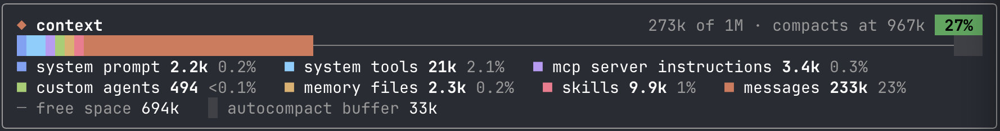</a><br>📊 <b>context-bar</b><br>what fills your context</td>
    <td align="center" width="33%"><a href="docs/mods.md#-review-watch">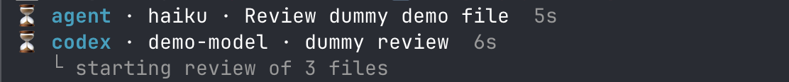</a><br>🔍 <b>review-watch</b><br>running code reviews, live</td>
    <td align="center" width="33%"><a href="docs/mods.md#-md-preview">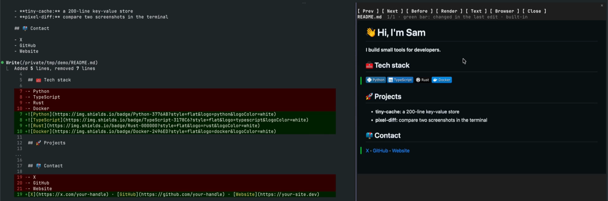</a><br>📝 <b>md-preview</b><br>Markdown rendered like GitHub</td>
  </tr>
  <tr>
    <td align="center" width="33%"><a href="docs/mods.md#-blast-radius">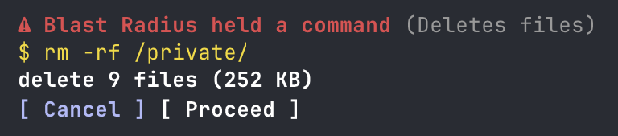</a><br>💥 <b>blast-radius</b><br>see what <code>rm -rf</code> would delete</td>
    <td align="center" width="33%"><a href="docs/mods.md#-now-playing"></a><br>🎵 <b>now-playing</b><br>Spotify and its lyrics, live</td>
    <td align="center" width="33%"><a href="docs/mods.md#-reels-and-snake">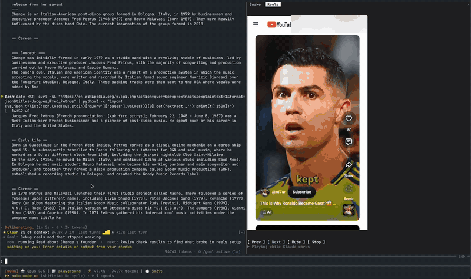</a><br>📱 <b>reels</b><br>Shorts while Claude works</td>
  </tr>
  <tr>
    <td align="center" width="33%"><a href="docs/mods.md#-where-am-i">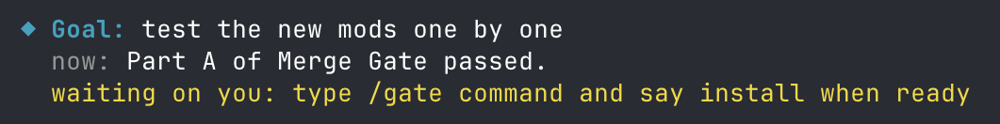</a><br>📍 <b>where-am-i</b><br>goal, now, waiting on you</td>
    <td align="center" width="33%"><a href="docs/mods.md#-lines-above-the-prompt">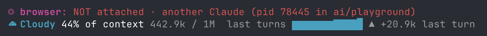</a><br>🌦️ <b>token-weather and friends</b><br>lines above the prompt</td>
    <td align="center" width="33%"><a href="#mission-control">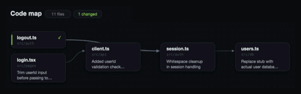</a><br>🛰️ <b>mission-control</b><br>agents and the code they touch</td>
  </tr>
  <tr>
    <td align="center" width="33%"><a href="docs/mods.md#-switchboard">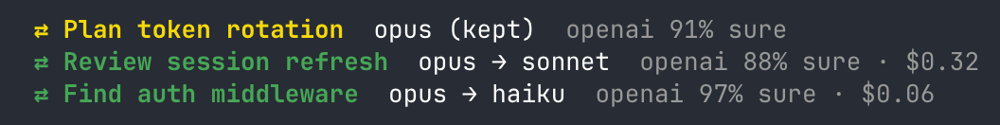</a><br>🔀 <b>switchboard</b><br>cheaper models for subagents</td>
    <td align="center" width="33%"><a href="docs/mods.md#-agent-radar">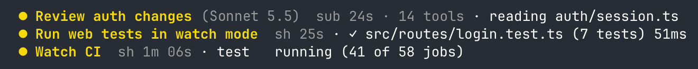</a><br>📡 <b>agent-radar</b><br>subagents and shells, live</td>
    <td align="center" width="33%"><a href="docs/mods.md#-reels-and-snake">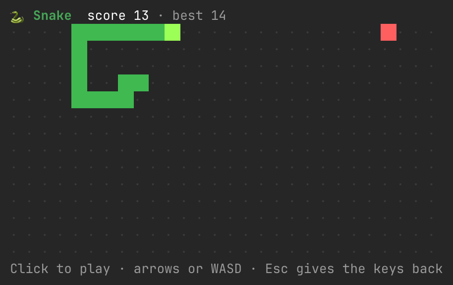</a><br>🐍 <b>snake</b><br>a game while Claude works</td>
  </tr>
</table>

## 🚀 Install

```sh
npx claude-code-mods@latest
```

Tick the mods you want in a checklist, see what each one adds, and press Enter to install. Untick a mod to disable it (its settings stay). Restart Claude Code after. `@latest` makes npx skip an old cached copy.

- `--project` installs for this project only
- `--dry-run` prints the `claude` commands instead of running them
- `--pick a,b` turns on exactly these mods, no checklist (`--pick ""` turns all off)
- `--yes-community` installs picked community mods without asking (outside a terminal they are skipped without it)
- `--help` shows usage

It edits the Claude profile that `claude` uses here, shown at the top. For another profile, set it first: `CLAUDE_CONFIG_DIR=~/.claude-other npx claude-code-mods@latest`.

### Order your bands

Press `o` in the checklist to order your bands (the lines above the prompt). Move the cursor with up/down or `j`/`k`, move a band with Shift+up/down or `K`/`J`, and press Enter to save. Esc goes back without saving. The order goes to `<config dir>/claude-code-mods/bands.json`, where the config dir is `CLAUDE_CONFIG_DIR` or `~/.claude`. Restart Claude Code to apply it. Bands not in the file sit on top.

### Other ways

By hand:

```sh
claude plugin marketplace add hamzafer/claude-code-mods
claude plugin install context-bar@claude-code-mods
```

To try one without installing:

```sh
git clone https://github.com/hamzafer/claude-code-mods && cd claude-code-mods
claude --plugin-dir mods/context-bar
```

> **Needs** Claude Code 2.1.287+. A few mods need more (Chrome, `gh`, a connector); the tables say which.

## 🧩 The mods

### 👀 See what's happening

| | Mod | What it does | Command |
| --- | --- | --- | --- |
| 🛰️ | **mission-control** | Live map of agents, tool calls and the code they touch | `/mission` |
| 📊 | **context-bar** | Your context window as one stacked bar, a color per category, with token counts and where it compacts | `/context-bar` |
| 🌦️ | **token-weather** | Context fill from Clear to Compact soon, plus a prompt-cache countdown | |
| ⏱️ | **cache-clock** | A prompt-cache line under your status line, from Claude Code's own figures: time left, hit rate and misses, and the tokens your next message re-caches once it goes cold. Needs Node and Claude Code 2.1.287+ | `/cache-clock setup` |
| 📍 | **where-am-i** | Goal, doing now, waiting on you, next step | `/where` |
| ➡️ | **next-steps** | 2 or 3 likely next prompts after each turn, one key to draft one. `language` sets their language, `layout: rows` keeps one per row | `1` `2` `3`, `0` hides |
| 💰 | **usage-meter** | 5-hour and 7-day plan usage, the reset countdown and the session's cost | |
| 🔥 | **heatmap** | A GitHub-style grid of your Claude Code time, with your streak, peak hours and top projects | `/heatmap` |
| 💳 | **openai-balance** | Your OpenAI API credit: an estimated balance with a gauge, today's spend, where the money mostly went, and the last call. Needs an OpenAI organization Admin key | `/openai-balance` |
| 🪙 | **openrouter-balance** | Your OpenRouter credit: the real balance with a gauge, today's spend and the model the money mostly went to. A regular API key shows the balance too when OpenRouter allows it, plus its own spend and limit | `/openrouter-balance` |
| 📡 | **agent-radar** | One live line per running subagent (with its model) or background shell | `/radar` |
| 🔍 | **review-watch** | One live line per running code review (Codex or a review subagent) with the model, target, elapsed time and Codex's latest output. A toast lists the findings when it ends | |
| 🌐 | **browser-lanes** | Whether this session has a browser, and who holds it | `/browser` |
| 🕌 | **prayer-times** | The current prayer and how long is left, the next one, and zawal. Computed on your computer, Hanafi or standard Asr | `/prayers` |
| 🎬 | **replay-theater** | Steps through the last turn's edits, one diff at a time | `/replay` |
| 📝 | **md-preview** | Renders the Markdown files Claude edits like GitHub does, with before and after side by side. Needs Chrome and a terminal that shows images | `/md` |

### 🛡️ Guard your repo

| | Mod | What it does | Command |
| --- | --- | --- | --- |
| 💥 | **blast-radius** | Holds `rm -r`, force pushes and migrations, shows what they'd delete, cancels after 60 s with no answer | |

### 💸 Spend less

| | Mod | What it does | Command |
| --- | --- | --- | --- |
| 🔀 | **switchboard** | Picks the model for each subagent that doesn't name one, with [OpenAI's Decisions API](https://developers.openai.com/api/docs/guides/decisions) or [Jev](https://docs.typesafe.ai), from its short label only. Shows what every subagent cost | `/route` |

### 🔧 My setup (fork and adapt)

These are built around my own tools and rules. Fork them and change the rules to yours.

| | Mod | What it does | Command |
| --- | --- | --- | --- |
| 👀 | **glance** | One line with what needs you: next meeting, PRs, Linear issues, Slack DMs. Needs `gh` and the Google Calendar, Linear and Slack connectors | `/glance` |
| 🚦 | **merge-gate** | Holds `gh pr merge` until CI is green and Codex reviewed once. Needs `gh` and the Codex CLI. Reviews run on one fixed model; change it to yours | `/gate` |
| 📏 | **rulebook-guard** | Enforces my writing and git rules: rewrites em dashes, asks before `--amend`, unformatted pushes, emails and phone numbers in notes | |
| 💾 | **session-saver** | Saves where you left off, shows it on resume. Needs [unpause](https://github.com/hamzafer/unpause) | `/park [note]` |

### 🎮 For fun (opt-in)

| | Mod | What it does | Command |
| --- | --- | --- | --- |
| 📱 | **reels** | YouTube Shorts while Claude works, pauses when it's done | `/reels` |
| 🐍 | **snake** | Snake while Claude works | `/snake` |
| 🎵 | **now-playing** | What Spotify is playing, with a progress bar, the lyric being sung, and ⏮ ⏸ ⏭ buttons. Needs macOS and the Spotify app | `/music` |

## 🤝 Community mods

Mods by other people, in their own marketplaces. They're not maintained here, so read the code before you install. They also show up last in the `npx claude-code-mods@latest` checklist.

| | Mod | What it does | Install |
| --- | --- | --- | --- |
| 🖼️ | **[image-view](https://github.com/jarrodwatts/claude-image-view)** by [@jarrodwatts](https://github.com/jarrodwatts) | See the images you paste into Claude Code: thumbnails above the prompt instead of bare [Image #1] tags | `claude plugin marketplace add jarrodwatts/claude-image-view` then `claude plugin install image-view@claude-image-view` |
| 🏷️ | **[last-prompt-title](https://github.com/zhangbububu/session-titles)** by [@zhangbububu](https://github.com/zhangbububu) | Session titles that follow your latest prompt: cut for the CLI, written by Haiku for the desktop sidebar | `claude plugin marketplace add zhangbububu/session-titles` then `claude plugin install last-prompt-title@session-titles` |
| 🌏 | **[cc-zh](https://github.com/jiangnanquan/claude-code-zh)** by [@jiangnanquan](https://github.com/jiangnanquan) | Simplified Chinese UI localization via static dictionary: slash-command descriptions, `/config` labels, spinner, hints, notices, command output, tool summaries and turn duration. Zero tokens / network; verified on CC 2.1.296 | `claude plugin marketplace add jiangnanquan/claude-code-zh` then `claude plugin install cc-zh@claude-code-zh` |
| 🎛️ | **[subagent-tuner](https://github.com/Kruhlikau/subagent-tuner)** by [@Kruhlikau](https://github.com/Kruhlikau) | Picks the model and effort of every subagent: a Manual/Auto band, a pick pane, review → Opus and search → Haiku, and a saved default that overrides what the agent asked for | `claude plugin marketplace add Kruhlikau/subagent-tuner` then `claude plugin install subagent-tuner@subagent-tuner` |
| 🛒 | **[mod-store](https://github.com/hellosverre/mod-store)** by [@hellosverre](https://github.com/hellosverre) | An app store in a pane: `/mods` browses, searches and installs about 2,700 community mods, with what each one can access shown before you install. Or ask Claude to find one | `claude plugin marketplace add hellosverre/mod-store` then `claude plugin install mod-store@mod-store` |
| 📈 | **[cache-meter](https://github.com/T-AI-Labs/claude-code-mods#cache-meter)** by [@T-AI-Labs](https://github.com/T-AI-Labs) | The share of each turn the prompt cache served, next to the context fill, with an auto-compact threshold and Compact and Clear buttons | `claude plugin marketplace add T-AI-Labs/claude-code-mods` then `claude plugin install cache-meter@T-AI-Labs` |
| ⏳ | **[usage-limits](https://github.com/T-AI-Labs/claude-code-mods#usage-limits)** by [@T-AI-Labs](https://github.com/T-AI-Labs) | 5-hour and weekly plan limits in percent, with the time left until each resets | `claude plugin marketplace add T-AI-Labs/claude-code-mods` then `claude plugin install usage-limits@T-AI-Labs` |
| 🟣 | **[pixel-pulse](https://github.com/air01aditya/pixel-pulse)** by [@air01aditya](https://github.com/air01aditya) | A purple pixel strip above the prompt that drifts right to left and glows under the pointer, and a purple pixel spiral in place of the working spinner. Desktop app only; it only draws | `claude plugin marketplace add air01aditya/pixel-pulse` then `claude plugin install pixel-pulse@pixel-pulse` |
| 🔗 | **[open-paths](https://github.com/kiankhooban/open-paths)** by [@kiankhooban](https://github.com/kiankhooban) | Click a file path in Claude's reply and the file opens in its app: Word, Preview or Excel for documents, your editor at the line for `app.py:42`, Finder for folders. Launchers, scripts and unknown types are never opened | `claude plugin marketplace add kiankhooban/open-paths` then `claude plugin install open-paths@open-paths` |
| 🎼 | **[workflow-conductor](https://github.com/bruw/workflow-conductor)** by [@bruw](https://github.com/bruw) | Terminal UI for planning, running and understanding complex agent workflows inside Claude Code: define the workflow as a graph, have Claude script and run it, and watch the run on the same graph. Needs Claude Code 2.1.296+ and a terminal 110+ columns wide | `claude plugin marketplace add bruw/workflow-conductor` then `claude plugin install workflow-conductor@workflow-conductor` |
| 💸 | **[bedrock-meter](https://github.com/weidu-tpvision/claude-mods/tree/main/bedrock-meter)** by [@weidu-tpvision](https://github.com/weidu-tpvision) | Token and USD meter for Claude Code on Amazon Bedrock: session cost, context fill, cache hit rate and today's total above the prompt, priced at AWS's own on-demand rates (refreshed weekly from the AWS price list), with a per-model breakdown in `/bedrock-cost` | `claude plugin marketplace add weidu-tpvision/claude-mods` then `claude plugin install bedrock-meter@weidu-claude-mods` |
| 📱 | **[brainrot-break](https://github.com/BordyV/brainrot-break)** by [@BordyV](https://github.com/BordyV) | A TikTok-style feed of 350+ pixel art mini-videos in a pane while Claude answers: scroll, like, pick your themes, and an end card when Claude is done. Every video is a small simulation drawn locally: no tokens, no model calls. Terminal and desktop app, in 6 languages. [Try it in the browser](https://bordyv.github.io/brainrot-break/) | `claude plugin marketplace add BordyV/brainrot-break` then `claude plugin install brainrot-break@brainrot-break` |
| 📥 | **[review-inbox](https://github.com/SummerRiversound/review-inbox)** by [@SummerRiversound](https://github.com/SummerRiversound) | Your GitHub review queue above the prompt: PRs waiting for your review, your PRs that need something and issues that mention you, a one-sentence summary of each review request, and `Review` to put the chosen PRs into the prompt. Needs `gh` logged in | `claude plugin marketplace add SummerRiversound/review-inbox` then `claude plugin install review-inbox@review-inbox` |
| 🎓 | **[cc-esol](https://github.com/rapha-rodrigues/cc-esol)** by [@rapha-rodrigues](https://github.com/rapha-rodrigues) | An English coach for non-native speakers: Claude logs a native rewrite of each English prompt you type or dictate, with the reasons, to a local learning log you read and review in a pane. A Voice button toggles Claude Code's dictation | `claude plugin marketplace add rapha-rodrigues/cc-esol` then `claude plugin install cc-esol@esol` |

Built one? Open a PR that adds a row.

<a id="mission-control"></a>

## 🛰️ Flagship: mission-control

Every subagent, every tool call and every file they touch, in a pane next to the chat. Shown at 4x: two subagents building a logout feature across four files.

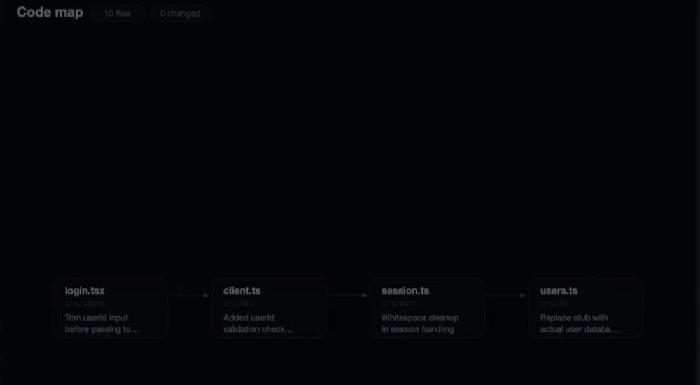

Install it like any mod, restart, and type `/mission` (or `/mission code` to open the code map). `q` closes it.

- 🤖 `w` shows the agents and every tool call, live
- 🗺️ `c` shows the code map, with import arrows
- 🔵 **Blue** while the agent reads a file
- 🟠 **Orange** while it writes
- 🟢 **Green** when done, with one line on what changed

> The Code view runs on macOS and Linux and needs Google Chrome or Chromium and a terminal that shows images (Ghostty, kitty, iTerm2). On Windows it lists the map as lines, and `b` opens the drawn map in your browser. The Who view works everywhere.

## 📚 More

- 📖 [**docs/mods.md**](docs/mods.md): how they behave, setup notes and build your own
- 🎥 [**docs/demo.md**](docs/demo.md): videos and screenshots
- ⭐ Earlier project: [**cursor-commands**](https://github.com/hamzafer/cursor-commands) [](https://github.com/hamzafer/cursor-commands), 600+ stars for Cursor slash commands
- 🤝 [**CONTRIBUTING.md**](CONTRIBUTING.md): add your own mod
