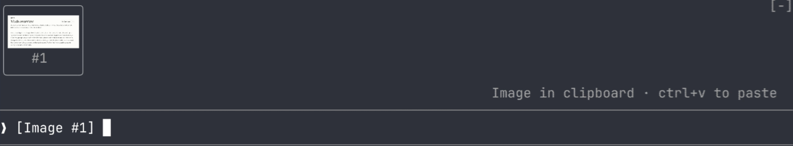

# Community mods

Back to the [README](../README.md).

Mods by other people, in their own marketplaces. They're not maintained here, so read the code before you install. They also show up last in the `npx claude-code-mods@latest` checklist.

## ⭐ Community pick: image-view

**[image-view](https://github.com/jarrodwatts/claude-image-view)** by [@jarrodwatts](https://github.com/jarrodwatts) shows the images you paste into Claude Code as thumbnails above the prompt, instead of bare `[Image #1]` tags.



<sub>Screenshot from the author's repo, cropped. The mod is maintained there, not here.</sub>

```sh
claude plugin marketplace add jarrodwatts/claude-image-view
claude plugin install image-view@claude-image-view
```

## All community mods

| | Mod | What it does | Install |
| --- | --- | --- | --- |
| 🖼️ | **[image-view](https://github.com/jarrodwatts/claude-image-view)** by [@jarrodwatts](https://github.com/jarrodwatts) | See the images you paste into Claude Code: thumbnails above the prompt instead of bare [Image #1] tags | `claude plugin marketplace add jarrodwatts/claude-image-view` then `claude plugin install image-view@claude-image-view` |
| 🏷️ | **[last-prompt-title](https://github.com/zhangbububu/session-titles)** by [@zhangbububu](https://github.com/zhangbububu) | Session titles that follow your latest prompt: cut for the CLI, written by Haiku for the desktop sidebar | `claude plugin marketplace add zhangbububu/session-titles` then `claude plugin install last-prompt-title@session-titles` |
| 🌏 | **[cc-zh](https://github.com/jiangnanquan/claude-code-zh)** by [@jiangnanquan](https://github.com/jiangnanquan) | Simplified Chinese UI localization via static dictionary: slash-command descriptions, `/config` labels, spinner, hints, notices, command output, tool summaries and turn duration. Zero tokens / network; verified on CC 2.1.296 | `claude plugin marketplace add jiangnanquan/claude-code-zh` then `claude plugin install cc-zh@claude-code-zh` |
| 🎛️ | **[subagent-tuner](https://github.com/Kruhlikau/subagent-tuner)** by [@Kruhlikau](https://github.com/Kruhlikau) | Picks the model and effort of every subagent: a Manual/Auto band, a pick pane, review → Opus and search → Haiku, and a saved default that overrides what the agent asked for | `claude plugin marketplace add Kruhlikau/subagent-tuner` then `claude plugin install subagent-tuner@subagent-tuner` |
| 🛒 | **[mod-store](https://github.com/hellosverre/mod-store)** by [@hellosverre](https://github.com/hellosverre) | An app store in a pane: `/mods` browses, searches and installs about 2,700 community mods, with what each one can access shown before you install. Or ask Claude to find one | `claude plugin marketplace add hellosverre/mod-store` then `claude plugin install mod-store@mod-store` |
| 📈 | **[cache-meter](https://github.com/T-AI-Labs/claude-code-mods#cache-meter)** by [@T-AI-Labs](https://github.com/T-AI-Labs) | The share of each turn the prompt cache served, next to the context fill, with an auto-compact threshold and Compact and Clear buttons | `claude plugin marketplace add T-AI-Labs/claude-code-mods` then `claude plugin install cache-meter@T-AI-Labs` |
| ⏳ | **[usage-limits](https://github.com/T-AI-Labs/claude-code-mods#usage-limits)** by [@T-AI-Labs](https://github.com/T-AI-Labs) | 5-hour and weekly plan limits in percent, with the time left until each resets | `claude plugin marketplace add T-AI-Labs/claude-code-mods` then `claude plugin install usage-limits@T-AI-Labs` |
| 🟣 | **[pixel-pulse](https://github.com/air01aditya/pixel-pulse)** by [@air01aditya](https://github.com/air01aditya) | A purple pixel strip above the prompt that drifts right to left and glows under the pointer, and a purple pixel spiral in place of the working spinner. Desktop app only; it only draws | `claude plugin marketplace add air01aditya/pixel-pulse` then `claude plugin install pixel-pulse@pixel-pulse` |
| 🔗 | **[open-paths](https://github.com/kiankhooban/open-paths)** by [@kiankhooban](https://github.com/kiankhooban) | Click a file path in Claude's reply and the file opens in its app: Word, Preview or Excel for documents, your editor at the line for `app.py:42`, Finder for folders. Launchers, scripts and unknown types are never opened | `claude plugin marketplace add kiankhooban/open-paths` then `claude plugin install open-paths@open-paths` |
| 🎼 | **[workflow-conductor](https://github.com/bruw/workflow-conductor)** by [@bruw](https://github.com/bruw) | Terminal UI for planning, running and understanding complex agent workflows inside Claude Code: define the workflow as a graph, have Claude script and run it, and watch the run on the same graph. Needs Claude Code 2.1.296+ and a terminal 110+ columns wide | `claude plugin marketplace add bruw/workflow-conductor` then `claude plugin install workflow-conductor@workflow-conductor` |
| 💸 | **[bedrock-meter](https://github.com/weidu-tpvision/claude-mods/tree/main/bedrock-meter)** by [@weidu-tpvision](https://github.com/weidu-tpvision) | Token and USD meter for Claude Code on Amazon Bedrock: session cost, context fill, cache hit rate and today's total above the prompt, priced at AWS's own on-demand rates (refreshed weekly from the AWS price list), with a per-model breakdown in `/bedrock-cost` | `claude plugin marketplace add weidu-tpvision/claude-mods` then `claude plugin install bedrock-meter@weidu-claude-mods` |
| 📱 | **[brainrot-break](https://github.com/BordyV/brainrot-break)** by [@BordyV](https://github.com/BordyV) | A TikTok-style feed of 350+ pixel art mini-videos in a pane while Claude answers: scroll, like, pick your themes, and an end card when Claude is done. Every video is a small simulation drawn locally: no tokens, no model calls. Terminal and desktop app, in 6 languages. [Try it in the browser](https://bordyv.github.io/brainrot-break/) | `claude plugin marketplace add BordyV/brainrot-break` then `claude plugin install brainrot-break@brainrot-break` |
| 📥 | **[review-inbox](https://github.com/SummerRiversound/review-inbox)** by [@SummerRiversound](https://github.com/SummerRiversound) | Your GitHub review queue above the prompt: PRs waiting for your review, your PRs that need something and issues that mention you, a one-sentence summary of each review request, and `Review` to put the chosen PRs into the prompt. Needs `gh` logged in | `claude plugin marketplace add SummerRiversound/review-inbox` then `claude plugin install review-inbox@review-inbox` |
| 🎓 | **[cc-esol](https://github.com/rapha-rodrigues/cc-esol)** by [@rapha-rodrigues](https://github.com/rapha-rodrigues) | An English coach for non-native speakers: Claude logs a native rewrite of each English prompt you type or dictate, with the reasons, to a local learning log you read and review in a pane. A Voice button toggles Claude Code's dictation | `claude plugin marketplace add rapha-rodrigues/cc-esol` then `claude plugin install cc-esol@esol` |
| ✍️ | **[grammar](https://github.com/jaklimoff/claude-grammar)** by [@jaklimoff](https://github.com/jaklimoff) | English fixes under each prompt you send, while you work: Haiku strikes the wrong words through in red, shows the fix in green and says why, and gives a native rewrite when a sentence is clearly a word-for-word translation. One Haiku call per prompt | `claude plugin marketplace add jaklimoff/claude-grammar` then `claude plugin install grammar@grammar` |
| 🗂️ | **[session-board](https://github.com/Avavaziri/claude-code-adhd-session-board)** by [@Avavaziri](https://github.com/Avavaziri) | An ADHD-friendly manager view for parallel sessions: a pane with one card per Claude session in a project, showing which one needs you, its unmerged git work and what it waits on, with buttons to answer its question. Desktop app only. Opens at each session start; Haiku re-summarizes changed sessions each minute, and status replies go to the card, not your chat | `claude plugin marketplace add Avavaziri/claude-code-adhd-session-board` then `claude plugin install session-board@session-board` |
| 🧭 | **[automode](https://github.com/mralexivy/AutoMode)** by [@mralexivy](https://github.com/mralexivy) | Picks the model and effort for each prompt, shows the route above the prompt, and tells Claude to run an independent review (Opus or Sonnet) on risky changes. On by default in every session: several Haiku calls per prompt, auto compacting, shortening long outputs and ending stuck turns | `claude plugin marketplace add mralexivy/AutoMode` then `claude plugin install automode@automode` |
| 🧰 | **[command-center](https://github.com/T-AI-Labs/claude-code-mods#command-center)** by [@T-AI-Labs](https://github.com/T-AI-Labs) | One row of dropdowns above the prompt for your agents, skills and commands, narrowed by where they come from: Insert puts the pick into the prompt, Run runs the command or skill or starts the agent in the background on what you typed. No network requests and no model calls of its own | `claude plugin marketplace add T-AI-Labs/claude-code-mods` then `claude plugin install command-center@T-AI-Labs` |
| 🔎 | **[cost-lens](https://github.com/ZachFara/cost-lens)** by [@ZachFara](https://github.com/ZachFara) | Where your Claude Code tokens and dollars go: a pane with plan limits, cost by day, model, project, branch and PR, what expired caches cost you, and a cache countdown above the prompt. Optional Haiku model tips (off by default); fetches Anthropic's price page once a day | `claude plugin marketplace add ZachFara/cost-lens` then `claude plugin install cost-lens@cost-lens` |
| 📊 | **[usage-bar](https://github.com/araujo-eduardo/claude-usage-bar)** by [@araujo-eduardo](https://github.com/araujo-eduardo) | A 7-day token history pane with per-model totals, plus the 5-hour and weekly plan limits with reset times, context fill and session cost in the status line, and a toast past 90% of the 5-hour window. English and pt-BR. No network requests and no model calls | `claude plugin marketplace add araujo-eduardo/claude-usage-bar` then `claude plugin install usage-bar@claude-usage-bar` |

Built one? Open a PR that adds a row.
