# 🎥 Demo

🏠 Back to the [README](../README.md), or read the [setup notes](mods.md).

## 🛰️ mission-control

Shown at 4x: two subagents building a logout feature across four files.

## 📊 context-bar

What fills the context window, one color per category.

## 🔍 review-watch

A Codex review and a review subagent running at once.

## 📝 md-preview

The diff Claude wrote on the left, the page rendered like GitHub on the right.

## 🕌 prayer-times

The current prayer, the time left, and the next one.

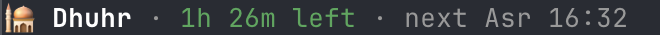

## 🎵 now-playing

The Spotify track with its progress, the ⏮ ⏸ ⏭ buttons, and the lyric being sung on the line below.

## 📱 reels

Plays Shorts while Claude works and pauses when it's done.

## 📚 Lines above the prompt

browser-lanes, token-weather and where-am-i stacked above the prompt.

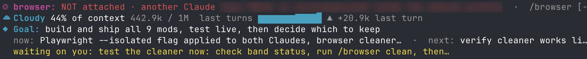

## 💥 blast-radius

Holds an `rm -rf` and shows what it would delete.

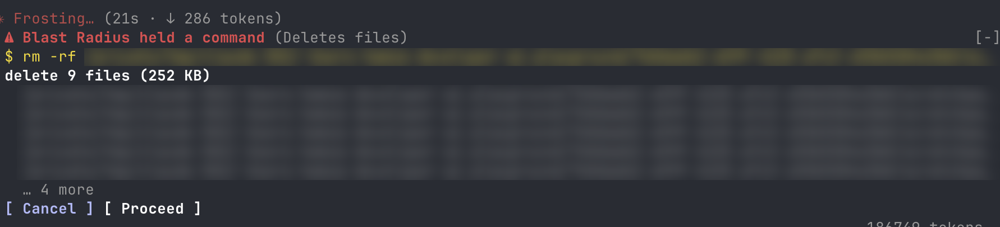

## 📏 rulebook-guard

Catches a `git commit --amend`.

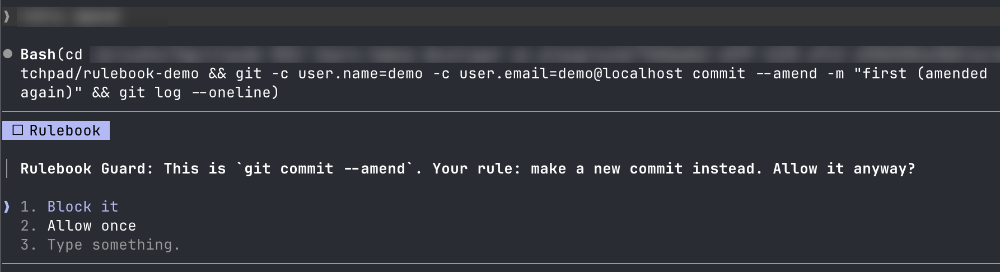

## 🎬 replay-theater

Steps through the last turn's edits.

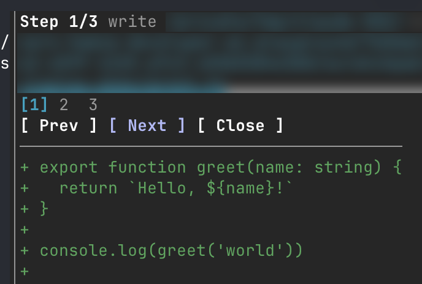

## 📍 where-am-i

Shown with token-weather above it.

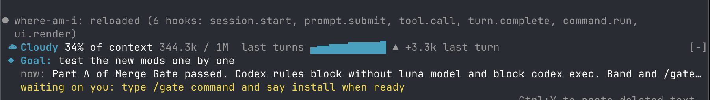

## ⏱️ cache-clock

A warm one-hour cache, under your own status line.

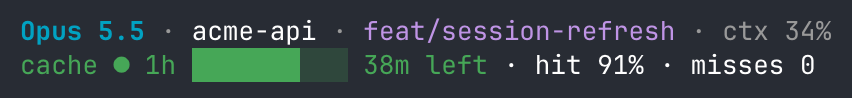

## ➡️ next-steps

Three next prompts: type a number to send one.

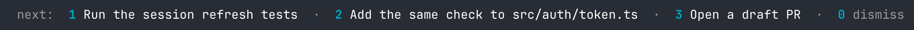

## 💰 usage-meter

Five-hour and weekly usage, with when each resets.

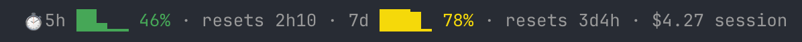

## 💳 openai-balance

The estimated balance, today's spend and the last call's model.

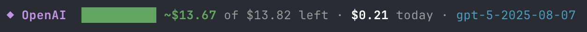

## 🪙 openrouter-balance

A regular API key: what its limit leaves and today's spend.

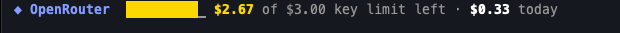

## 📡 agent-radar

A subagent and two background shells, each with its latest line.

## 🔀 switchboard

One subagent kept on opus, two switched to cheaper models.

## 👀 glance

The next meeting, a PR waiting on you, an issue and a DM, on one line.

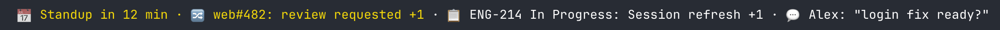

## 🚦 merge-gate

A PR with CI green and the Codex review still to come.

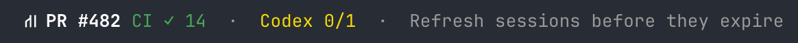

## 💾 session-saver

Where you left off last time, the next step and your note.

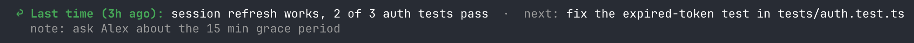

## 🐍 snake

Snake in a pane, mid-game.

